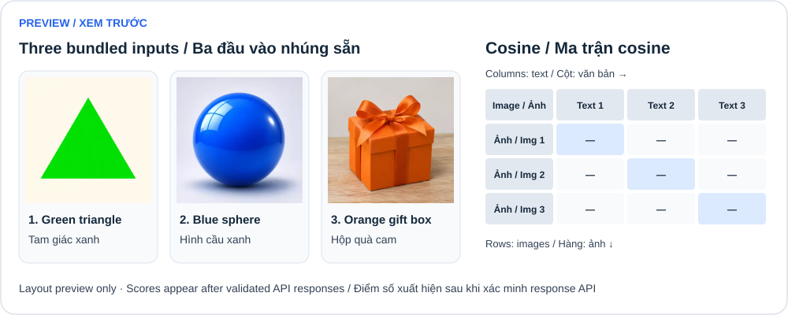

# Multimodal Embeddings AI Inference

**An API for image and text embeddings, with MIT-licensed project code and documentation.** Build semantic search, text-to-image retrieval and image similarity features with [Qwen/Qwen3-VL-Embedding-8B](https://huggingface.co/Qwen/Qwen3-VL-Embedding-8B) and [tencent/WeMM-Embedding-9B](https://huggingface.co/tencent/WeMM-Embedding-9B).

[](https://github.com/dangkhoa2016/Multimodal-Embeddings-AI-Inference/actions/workflows/ci.yml) [](pyproject.toml) [](LICENSE) [](pyproject.toml)
[](https://fastapi.tiangolo.com/) [](https://modal.com/) [](docs/API_CONTRACT.md)

🌐 Language / Ngôn ngữ: **English** | [Tiếng Việt](README.vi.md)

**Quick links:** [Try local mock](#try-the-api-locally) · [Open Demo in Colab](https://colab.research.google.com/github/dangkhoa2016/Multimodal-Embeddings-AI-Inference/blob/main/notebooks/multimodal_embeddings_api_demo.ipynb) · [Open Benchmark in Colab](https://colab.research.google.com/github/dangkhoa2016/Multimodal-Embeddings-AI-Inference/blob/main/notebooks/multimodal_embeddings_benchmark.ipynb) · [Deploy on Modal](#deploy-on-modal)

**Deployment homepage:** Opening `/` shows a bilingual, public introduction to the self-hosted API. `GET /health` and `GET /v1/models` are public; per-model detail, jobs and inference still require Bearer authentication. Visiting these pages does not start GPU inference.

**Testing and verification:** See the [test strategy](docs/TESTING.md) for CPU coverage, real-model evidence limitations, retrieval-quality evaluation and opt-in GPU checks.

**Choose a notebook:** The Demo explores three image–text pairs and a 3 × 3 cosine matrix; the Benchmark measures serving latency and bounded concurrency, not retrieval accuracy.

**Full measured benchmark (17 November 2026 UTC):** [English report](benchmarks/results/full-2026-11-17.md) · [Báo cáo tiếng Việt](benchmarks/results/full-2026-11-17.vi.md) · [JSON data](benchmarks/results/full-2026-11-17.json) · [provenance](benchmarks/results/full-2026-11-17.provenance.json) · [verified Release archive](https://github.com/dangkhoa2016/Multimodal-Embeddings-AI-Inference/releases/download/v1.0.0/multimodal_embeddings_benchmark_evidence_2026-11-17.zip). The completed run includes 65 POST requests and 68 embedding items. Its source SHA is corroborated by Modal deployment history; this is not independent GPU hardware attestation. Original deployed-source Git bundle: https://github.com/dangkhoa2016/Multimodal-Embeddings-AI-Inference/releases/download/v1.0.0/multimodal_embeddings_deployed_source_44f1f0c.bundle. The bundle retains the exact original deployment commit 44f1f0c30c6c5ff77b590df530bf9968cc177c24.

**Notebook snapshots:** The quick links above open the maintained notebooks on `main`. To use the pinned `v1.0.0` source snapshot, open its [Demo](https://colab.research.google.com/github/dangkhoa2016/Multimodal-Embeddings-AI-Inference/blob/v1.0.0/notebooks/multimodal_embeddings_api_demo.ipynb) or [Benchmark](https://colab.research.google.com/github/dangkhoa2016/Multimodal-Embeddings-AI-Inference/blob/v1.0.0/notebooks/multimodal_embeddings_benchmark.ipynb). At this publication, the release tag and `main` have matching notebook contents; `main` may change later.

Use the project in your own applications, adapt it to your needs, and contribute improvements. It includes a FastAPI service, deployment on Modal with a dedicated NVIDIA L40S worker for each model, HTTP client examples and bilingual notebooks for Google Colab and Kaggle.


## Intended audience and project scope

This open-source project is designed primarily for individual developers,
researchers and teams running their own image–text embedding API. It provides
a self-managed inference backend, not a complete business SaaS or enterprise
multi-tenant application.

The API includes foundational **multi-client** controls (per-client API keys,
scoped async job access, admission limits and optional shared rate limiting).
These are **not** a substitute for end-user account management, organization
administration, role-based permissions, tenant-specific metering and billing,
centralized operations or deployment-specific security validation. Organizations
can build on the MIT-licensed code, including for commercial applications, but
must implement and validate the additional capabilities their use case requires;
upstream models and dependencies retain their separate license terms.

## Get started

| Your goal | Start here | What you need |
| --- | --- | --- |
| Explore the API locally | [Local quickstart](#try-the-api-locally) | Python 3.11–3.13, Git, curl and Bash; no GPU or Modal account |
| Connect an application or notebook | [HTTP examples](#call-the-api) or [interactive notebook](#try-the-notebook) | A deployed API URL and token |
| Run your own inference service | [Modal deployment](#deploy-on-modal) and [first-time checklist](docs/OPERATIONS.md#first-time-deployment-prerequisites-and-order) | A Modal account with GPU and storage quota |



*Illustrative notebook layout; not a measured inference result.*

## What you can build

- **Text-to-image search:** find images that match a natural-language description.
- **Image similarity:** retrieve related images from your collection.
- **Multimodal applications:** add image and text retrieval to a backend, gallery or RAG workflow.

Store the vectors in a search index or vector database of your choice. Use the same model, revision and compatible encoding settings for the vectors you compare.

## Supported models

| Full Hugging Face model name | API ID | Parameters | Supported dimensions |
| --- | --- | ---: | --- |
| [Qwen/Qwen3-VL-Embedding-8B](https://huggingface.co/Qwen/Qwen3-VL-Embedding-8B) | `qwen3-vl-embedding-8b` | 8B | 64–4096 |
| [tencent/WeMM-Embedding-9B](https://huggingface.co/tencent/WeMM-Embedding-9B) | `wemm-embedding-9b` | 9B | 64, 128, 256, 512, 1024, 2048, 4096 |

The default output size is **1,024 dimensions** for both models. Their vector spaces are independent: do not mix embeddings across different models, revisions or preprocessing policies.

## Try the API locally

From a Bash terminal, including WSL on Windows:

```bash
git clone https://github.com/dangkhoa2016/Multimodal-Embeddings-AI-Inference.git
cd Multimodal-Embeddings-AI-Inference
git checkout v1.0.0
bash scripts/setup.sh --quick
bash scripts/quickstart_mock.sh
```

The script starts a temporary local API, sends an authenticated request and shuts it down. A successful run prints `"pass": true` and `"backend": "mock"`. This mode uses synthetic vectors so you can explore the API without downloading models. For model-generated embeddings, connect to a [Modal deployment](#deploy-on-modal).

To send your own local requests, follow the [persistent mock server setup](docs/CLIENT_INTEGRATION.md#local-mock-server).

## Call the API

Any language that supports HTTP and JSON can use the service. Set `VISION_EMBEDDINGS_API_TOKEN` in your environment or secret manager. The following is a **synchronous compatibility example**; for GPU cold-start use the [async jobs](#avoid-duplicate-gpu-inference-with-async-jobs) described below:

```bash
curl --fail-with-body --silent --show-error -X POST 'https://YOUR_DEPLOYMENT.modal.run/v1/embeddings' \
  -H "Authorization: Bearer $VISION_EMBEDDINGS_API_TOKEN" \
  -H 'Content-Type: application/json' \
  -d '{"model":"wemm-embedding-9b","text":"a mountain landscape","dimension":1024}'
```

To embed a local PNG image (rather than text), use raw Base64 bytes without a `data:` prefix. Change `example.png` to an image on your machine:

```bash
python3 - <<'PYTHON' | curl --fail-with-body --silent --show-error \
  'https://YOUR_DEPLOYMENT.modal.run/v1/embeddings' \
  -H "Authorization: Bearer $VISION_EMBEDDINGS_API_TOKEN" \
  -H 'Content-Type: application/json' --data-binary @-
import base64
import json
from pathlib import Path

print(json.dumps({
    "model": "wemm-embedding-9b",
    "image_base64": base64.b64encode(Path("example.png").read_bytes()).decode("ascii"),
    "dimension": 1024,
}))
PYTHON
```

For model-specific per-request overrides, use the optional JSON model_config object, with supported options discoverable from GET /v1/models/{model_id}. See the [per-model configuration guide](docs/MODEL_CONFIGURATION.md). The original 1024-dimensional default remains unchanged. See also the [Python, Node.js and C#/.NET client guide](docs/CLIENT_INTEGRATION.md) and [API contract](docs/API_CONTRACT.md).

### Example response (abbreviated)

Illustrative, abbreviated JSON—not a captured API result. The vector and latency numbers are invented; a real 1,024-dimensional vector has 1,024 entries.

```json
{
  "model": "wemm-embedding-9b",
  "revision": "<checkpoint-revision>",
  "dimension": 1024,
  "vector": [0.0123, -0.0456, 0.0789],
  "normalized": true,
  "input_sha256": "<computed SHA-256 of the input>",
  "elapsed_ms": 152.4,
  "embedding_metadata": {
    "config_sha256": "<embedding configuration SHA-256>"
  }
}
```

See the [complete API schema](docs/API_CONTRACT.md).

## Avoid duplicate GPU inference with async jobs

For GPU cold starts, submit to [`POST /v1/embeddings/async`](docs/API_CONTRACT.md#async-gpu-jobs-cold-starts-and-resume)
with a stable `request_id`, then poll the returned `job_id` using GET.
The demo notebook uses this mode for Modal; `RUN_API_DEMO=True` explicitly enables live API/GPU work, with no second approval switch.

Completed results can be resumed while a verified local checkpoint or backend
record remains available. Backend records expire after about seven days of
inactivity; stable IDs do not provide permanent storage. If a submission reply
is lost **before a job ID is received**, use the read-only
`GET /v1/embeddings/jobs/by-request/{request_id}` endpoint with the original
authenticated client ID (including after its key is rotated); if an ID was saved, use the regular GET status endpoint.
Neither operation starts GPU work. For an `INDETERMINATE` job, inspect its
original status and deployment logs. **Never automatically repeat the POST**,
even with the same request ID, because an expired backend record could trigger
new billable work. See [recovery guidance](docs/OPERATIONS.md#controlled-reconciliation-for-overdue-async-jobs) and [durable async safety](docs/ASYNC_RELIABILITY.md).
Keep checkpoints private because they contain vectors.
The synchronous API remains available for compatibility.

## Try the notebook

[Open in Google Colab](https://colab.research.google.com/github/dangkhoa2016/Multimodal-Embeddings-AI-Inference/blob/main/notebooks/multimodal_embeddings_api_demo.ipynb) · [Download or view the notebook](notebooks/multimodal_embeddings_api_demo.ipynb) · [Notebook guide](docs/NOTEBOOK_GUIDE.md)

Choose a model, explore the three sample pairs, then connect your API to generate embeddings. The notebook runs on a CPU runtime and shows a bilingual report with a 3 × 3 cosine matrix: **image rows, text columns**. You can preview the bundled images **without an API URL or token**. The example matrix in the notebook remains unchanged; after inference, the Results cell renders a separate measured matrix below it. Custom image paths change the inference inputs. Set `PREVIEW_CUSTOM_IMAGES=True` to also display those images in notebook outputs. Kaggle users can import the same notebook file.

**Safe Run All:** With `RUN_API_DEMO=False`, the Demo Notebook only previews bundled samples, without prompts, HTTP or GPU work, **even when API credentials are configured**. Set `RUN_API_DEMO=True` in **Model configuration** to enable live API requests and potentially billable GPU inference; use hidden URL/token prompts or environment credentials. Repeated runs reuse verified cached vectors or resume saved jobs when possible.

## Measure serving performance

[Open the benchmark in Google Colab](https://colab.research.google.com/github/dangkhoa2016/Multimodal-Embeddings-AI-Inference/blob/main/notebooks/multimodal_embeddings_benchmark.ipynb) · The [performance notebook](notebooks/multimodal_embeddings_benchmark.ipynb) measures warm latency, optional cold starts, model routing and bounded concurrent requests against your deployment. It exports a JSON report for comparing runs.

[Recorded GPU results from 2026-11-08](benchmarks/results/README.md) include 35 benchmark POST requests and a separate ten-request overload check. The report describes the deployment measured on that date and links to the original JSON data.

`RUN_BENCHMARK=False` is the default. Enabling it with the default settings sends **24 POST requests**, including warm-ups. See the [benchmark guide](benchmarks/README.md) for measurement settings, interruption recovery and interpretation.

**Viewing note:** Colab provides compact form controls; Kaggle and other Jupyter viewers may show long implementation cells expanded. Run the numbered configuration and execution cells in order, without editing the hidden helper code. The benchmark report includes a deliberately illustrative layout with unavailable values; only real API responses populate measured results.

**Release integrity:** The [`v1.0.0` release](https://github.com/dangkhoa2016/Multimodal-Embeddings-AI-Inference/releases/tag/v1.0.0) contains five assets: two notebooks, the benchmark evidence ZIP, `SHA256SUMS.txt` (repository-relative source checksums) and `SHA256SUMS.release.txt` (flat checksums for the other four downloads). Run `sha256sum -c SHA256SUMS.txt` from the repository root to check source files. For downloads, place all five assets in the same directory and run `sha256sum -c SHA256SUMS.release.txt`. Regenerate the flat manifest from the tag with `python scripts/build_release_checksums.py --git-ref v1.0.0 --include-supplementary --output SHA256SUMS.release.txt`.

For an independent audit of all five downloaded assets, use the source checkout and run `python scripts/verify_release_assets.py --directory /path/to/downloads --git-ref v1.0.0 --require-supplementary`. This rejects missing, unexpected or tampered assets, including an omitted evidence ZIP.

## Deploy on Modal

For a fresh installation, clone the repository using your GitHub access,
then use Bash on Linux/macOS or Windows WSL, Python 3.11–3.13,
and a Modal Workspace with billing, storage and sufficient L40S GPU access.
**Before downloads or inference**, configure a Workspace usage budget and
spend limit; remote CPU downloads, model storage, image builds and GPU calls
can incur charges. You do **not** need a local GPU. Follow the
[step-by-step first-time deployment checklist](docs/OPERATIONS.md#first-time-deployment-prerequisites-and-order).

From the cloned repository, install the tools, select **one existing Modal
Environment**, and download both pinned models in that same Workspace and
Environment:

```bash
bash scripts/setup.sh --quick
source .venv/bin/activate
python -m pip install -e '.[modal]'
python -m modal --version
python -m modal setup
modal profile list
modal environment list
export MODAL_ENVIRONMENT="YOUR_ENVIRONMENT"
modal run modal_models.py --selection both
```

The Modal extra installs both the CLI and `python-dotenv`. Run `python scripts/create_modal_secret.py` in the same activated environment; the helper checks both dependencies before creating Secrets. If needed, rerun `python -m pip install -e '.[modal]'`.


Confirm that the downloader prints **two `READY` lines** with pinned
model revision SHAs. Follow [Configure authentication](docs/OPERATIONS.md#configure-authentication)
to create **two separate Modal Secrets** using those exact SHAs, then deploy
in the same Environment:

```bash
modal deploy modal_app.py
```

A successful `modal deploy` is **not** proof of GPU readiness. First inspect
the App, two Volumes and two Secrets, then follow the
[deployment verification guide](docs/VERIFICATION.md) for **two distinct,
potentially billable tests**: direct GPU worker inference and authenticated
HTTPS inference for both models. The HTTPS sync path has a 60-second default
server deadline; on a cold-start `504`, inspect the original work instead
of automatically retrying. See [Operations](docs/OPERATIONS.md) for logs,
permissions, costs and recovery. Use your own deployment URL and keep the
Bearer token private.

## Architecture

```text
Any HTTPS client ---> FastAPI Gateway (CPU / Bearer)
                           |                 |
                   synchronous API     async submit / poll
                           |                 |
                           |            Modal Dict (jobs/results)
                           |                 |
                           |            CPU coordinator (heartbeat)
                           |                 |
                           +--------+--------+
                                    |
                                route(model)
                                    |
               +--------------------+---------------------+
               |                                          |
           Qwen L40S                                  WeMM L40S
               |                                          |
          Qwen Volume                                WeMM Volume
               |                                          |
  Qwen/Qwen3-VL-Embedding-8B                  tencent/WeMM-Embedding-9B
```

Each GPU worker loads only its assigned model; each worker scales to zero independently. The optional async route additionally uses a detached CPU job coordinator and a Modal Dict for job status and completed vectors.

## Security and operational safeguards

Deploy the service in your own Modal account, then connect applications or notebooks using its HTTPS URL and an API token. For production use, optional safeguards include hashed API keys per client, isolated async job results and limits on outstanding GPU jobs. Redis/Valkey can share rate limits (measured in embedding units) and synchronous concurrency limits across CPU gateways; shared admission is required when running multiple gateways. See [Modal operations](docs/OPERATIONS.md#distributed-rate-limiting-and-gateway-overload-protection) and the [Security guide](docs/SECURITY.md) for configuration, monitoring and limitations. These safeguards do not replace a workspace budget or spend limit.

## Using the service

- Keep API tokens in your application's backend. Enter notebook credentials through the hidden prompts and clear outputs before sharing.
- Configure access controls and spending limits for your deployment; see [Operations](docs/OPERATIONS.md#access-control-and-spending-safeguards).
- Evaluate retrieval quality on data representative of your application. Cosine similarity is not a confidence percentage.

## Documentation

| Task | Guide |
| --- | --- |
| Integrate a client | [HTTP examples](docs/CLIENT_INTEGRATION.md) · [API reference](docs/API_CONTRACT.md) |
| Use Colab or Kaggle | [Notebook guide](docs/NOTEBOOK_GUIDE.md) · [Performance benchmark](benchmarks/README.md) |
| Deploy and operate | [First-time setup and operations](docs/OPERATIONS.md#first-time-deployment-prerequisites-and-order) · [Model storage](docs/MODEL_VOLUMES.md) |
| Diagnose a problem | [Troubleshooting](docs/TROUBLESHOOTING.md) · [Deployment checks](docs/VERIFICATION.md) |

## Contributing and support

Bug reports, feature ideas, documentation improvements and code contributions are welcome. You can help with examples, English/Vietnamese translations, integrations or model support.

Start with [Contributing](CONTRIBUTING.md), [open an issue](https://github.com/dangkhoa2016/Multimodal-Embeddings-AI-Inference/issues/new/choose), or read the [support guide](.github/SUPPORT.md). Community participation follows the [Code of conduct](.github/CODE_OF_CONDUCT.md). Report security issues privately using the [security policy](SECURITY.md).

See the [release notes](CHANGELOG.md) for version `1.0.0`.

## License and maintainer

The project's own code and documentation are MIT-licensed. Model weights and dependencies retain their respective licenses; see [License notes](LICENSE-NOTES.md).

**Maintainer:** Đăng Khoa · `i.am@dangkhoa.dev`.
