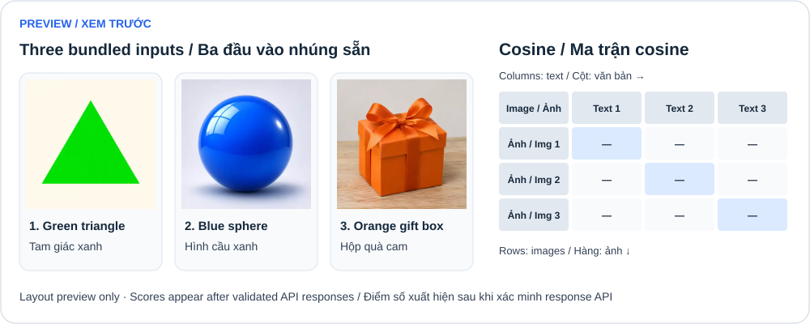

# Multimodal Embeddings AI Inference

**API tạo embedding ảnh và văn bản, với mã nguồn và tài liệu của dự án được cấp phép MIT.** Xây dựng tính năng tìm kiếm ngữ nghĩa, tìm ảnh bằng văn bản và tìm ảnh tương đồng với [Qwen/Qwen3-VL-Embedding-8B](https://huggingface.co/Qwen/Qwen3-VL-Embedding-8B) và [tencent/WeMM-Embedding-9B](https://huggingface.co/tencent/WeMM-Embedding-9B).

[](https://github.com/dangkhoa2016/Multimodal-Embeddings-AI-Inference/actions/workflows/ci.yml)  [](LICENSE) [](pyproject.toml)
[](https://fastapi.tiangolo.com/) [](https://modal.com/) [](docs/API_CONTRACT.vi.md)

🌐 Ngôn ngữ / Language: [English](README.md) | **Tiếng Việt**

**Truy cập nhanh:** [Chạy thử mock](#thử-api-cục-bộ) · [Mở Demo trên Colab](https://colab.research.google.com/github/dangkhoa2016/Multimodal-Embeddings-AI-Inference/blob/main/notebooks/multimodal_embeddings_api_demo.ipynb) · [Mở Benchmark trên Colab](https://colab.research.google.com/github/dangkhoa2016/Multimodal-Embeddings-AI-Inference/blob/main/notebooks/multimodal_embeddings_benchmark.ipynb) · [Triển khai Modal](#triển-khai-trên-modal)

Bạn có thể sử dụng dự án trong ứng dụng của mình, tùy chỉnh theo nhu cầu và đóng góp cải tiến cho cộng đồng. Dự án gồm dịch vụ FastAPI, cấu hình triển khai trên Modal với một NVIDIA L40S worker riêng cho mỗi model, ví dụ HTTP client và notebook song ngữ cho Google Colab, Kaggle.


## Bắt đầu

| Bạn muốn | Bắt đầu tại | Cần chuẩn bị |
| --- | --- | --- |
| Khám phá API trên máy của mình | [Chạy thử cục bộ](#thử-api-cục-bộ) | Python 3.11–3.13, Git, curl và Bash; không cần GPU hay tài khoản Modal |
| Kết nối ứng dụng hoặc notebook | [Ví dụ HTTP](#gọi-api) hoặc [notebook tương tác](#trải-nghiệm-notebook) | URL và token của API đã triển khai |
| Vận hành dịch vụ inference riêng | [Triển khai trên Modal](#triển-khai-trên-modal) và [checklist lần đầu](docs/OPERATIONS.vi.md#triển-khai-lần-đầu-điều-kiện-và-trình-tự) | Tài khoản Modal có quota GPU và lưu trữ |



*Bố cục notebook minh họa; không phải kết quả inference đo thực tế.*

Bạn triển khai dịch vụ trong tài khoản Modal của mình, sau đó kết nối ứng dụng hoặc notebook bằng URL HTTPS và API token. Khi vận hành thực tế, các biện pháp bảo vệ tùy chọn gồm API key được băm riêng cho từng client, cách ly kết quả job bất đồng bộ và giới hạn số GPU job đang chờ hoàn tất. Redis/Valkey cho phép dùng chung hạn mức tốc độ (tính theo số embedding) và giới hạn request đồng bộ đang xử lý giữa các CPU gateway; khi chạy nhiều gateway thì bắt buộc dùng cơ chế kiểm soát chung này. Xem [hướng dẫn vận hành Modal](docs/OPERATIONS.vi.md#rate-limit-phân-tán-và-bảo-vệ-gateway-khi-quá-tải) và [tài liệu Bảo mật](docs/SECURITY.vi.md) để cấu hình, giám sát và hiểu các giới hạn. Những biện pháp này không thay thế ngân sách hoặc giới hạn chi tiêu tại Workspace.

## Bạn có thể xây dựng gì?

- **Tìm ảnh bằng văn bản:** tra cứu ảnh phù hợp với mô tả bằng ngôn ngữ tự nhiên.
- **Tìm ảnh tương đồng:** tìm các hình ảnh liên quan trong bộ sưu tập của bạn.
- **Ứng dụng đa phương thức:** bổ sung tìm kiếm ảnh và văn bản cho backend, thư viện ảnh hoặc quy trình RAG.

Lưu vector trong chỉ mục tìm kiếm hoặc cơ sở dữ liệu vector bạn chọn. Các vector dùng để so sánh cần được tạo từ cùng model, revision và cấu hình mã hóa tương thích.

## Model được hỗ trợ

| Tên đầy đủ trên Hugging Face | Mã API | Tham số | Số chiều hỗ trợ |
| --- | --- | ---: | --- |
| [Qwen/Qwen3-VL-Embedding-8B](https://huggingface.co/Qwen/Qwen3-VL-Embedding-8B) | `qwen3-vl-embedding-8b` | 8B | 64–4096 |
| [tencent/WeMM-Embedding-9B](https://huggingface.co/tencent/WeMM-Embedding-9B) | `wemm-embedding-9b` | 9B | 64, 128, 256, 512, 1024, 2048, 4096 |

Cả hai model mặc định trả về **1.024 chiều**. Không gian vector của chúng độc lập: không trộn embedding giữa các model, revision hoặc quy tắc tiền xử lý khác nhau.

## Thử API cục bộ

Trong Bash terminal, hoặc WSL trên Windows:

```bash
git clone https://github.com/dangkhoa2016/Multimodal-Embeddings-AI-Inference.git
cd Multimodal-Embeddings-AI-Inference
bash scripts/setup.sh --quick
bash scripts/quickstart_mock.sh
```

Script khởi động API cục bộ tạm thời, gửi request có xác thực rồi tắt dịch vụ. Khi thành công, kết quả có `"pass": true` và `"backend": "mock"`. Chế độ này dùng vector mô phỏng để bạn khám phá API mà không cần tải model. Để tạo embedding bằng model, kết nối tới [deployment Modal](#triển-khai-trên-modal).

Để tự gửi request cục bộ, làm theo [hướng dẫn giữ mock server chạy](docs/CLIENT_INTEGRATION.vi.md#mock-server-cục-bộ).

## Gọi API

Mọi ngôn ngữ hỗ trợ HTTP và JSON đều có thể sử dụng dịch vụ. Đặt `VISION_EMBEDDINGS_API_TOKEN` trong biến môi trường hoặc nơi quản lý secret. Ví dụ sau dùng API đồng bộ **để tương thích**; khi GPU cold-start nên dùng [API async](#tránh-gpu-inference-trùng-với-job-bất-đồng-bộ) bên dưới:

```bash
curl --fail-with-body --silent --show-error -X POST 'https://YOUR_DEPLOYMENT.modal.run/v1/embeddings' \
  -H "Authorization: Bearer $VISION_EMBEDDINGS_API_TOKEN" \
  -H 'Content-Type: application/json' \
  -d '{"model":"wemm-embedding-9b","text":"a mountain landscape","dimension":1024}'
```

Để gửi ảnh PNG trên máy (thay cho văn bản), truyền các byte Base64 thuần, không có tiền tố `data:`. Thay `example.png` bằng đường dẫn tới ảnh của bạn:

```bash
python3 - <<'PYTHON' | curl --fail-with-body --silent --show-error \
  'https://YOUR_DEPLOYMENT.modal.run/v1/embeddings' \
  -H "Authorization: Bearer $VISION_EMBEDDINGS_API_TOKEN" \
  -H 'Content-Type: application/json' --data-binary @-
import base64
import json
from pathlib import Path

print(json.dumps({
    "model": "wemm-embedding-9b",
    "image_base64": base64.b64encode(Path("example.png").read_bytes()).decode("ascii"),
    "dimension": 1024,
}))
PYTHON
```

Xem [ví dụ Python](docs/CLIENT_INTEGRATION.vi.md#python-311-thư-viện-chuẩn), [hướng dẫn client Python, Node.js và C#/.NET](docs/CLIENT_INTEGRATION.vi.md) cùng [tài liệu API](docs/API_CONTRACT.vi.md) để dùng batch, instruction Qwen tùy chỉnh và xử lý lỗi.

### Ví dụ response rút gọn

JSON minh họa đã rút gọn, không phải phản hồi đo thực tế. Các giá trị vector và độ trễ là ví dụ; vector thật có đủ 1.024 phần tử.

```json
{
  "model": "wemm-embedding-9b",
  "revision": "<checkpoint-revision>",
  "dimension": 1024,
  "vector": [0.0123, -0.0456, 0.0789],
  "normalized": true,
  "input_sha256": "<computed SHA-256 of the input>",
  "elapsed_ms": 152.4,
  "embedding_metadata": {
    "config_sha256": "<embedding configuration SHA-256>"
  }
}
```

Xem [schema API đầy đủ](docs/API_CONTRACT.vi.md).

## Tránh GPU inference trùng với job bất đồng bộ

Khi GPU cold-start, gửi [`POST /v1/embeddings/async`](docs/API_CONTRACT.vi.md#gpu-job-bất-đồng-bộ-cold-start-và-khôi-phục)
với `request_id` ổn định, rồi GET trạng thái bằng `job_id` trả về.
Notebook demo dùng chế độ này với Modal và yêu cầu bật
`APPROVE_NEW_GPU_JOBS=True` trước khi tạo GPU job mới có thể phát sinh phí.

Có thể lấy lại kết quả khi checkpoint cục bộ đã xác minh hoặc bản ghi backend
vẫn còn. Bản ghi backend hết hạn sau khoảng bảy ngày không hoạt động; ID ổn định
không bảo đảm lưu trữ vĩnh viễn. Nếu mất phản hồi submit **trước khi nhận job
ID**, hãy dùng endpoint chỉ đọc
`GET /v1/embeddings/jobs/by-request/{request_id}` bằng API key còn hiệu lực của cùng client ID ban đầu,
kể cả sau khi xoay key.
Nếu đã lưu job ID, tiếp tục GET trạng thái như thường lệ. Cả hai thao tác
đều không gọi GPU. Với `INDETERMINATE`, kiểm tra job và deployment log.
**Không tự POST lại**, kể cả cùng request ID, vì record hết hạn có thể
gây GPU work tính phí mới. Xem [hướng dẫn khôi phục](docs/OPERATIONS.vi.md#đối-soát-thủ-công-các-job-async-quá-hạn).
Giữ cache chứa vector riêng tư.
API đồng bộ vẫn hoạt động để tương thích.

## Trải nghiệm notebook

[Mở trên Google Colab](https://colab.research.google.com/github/dangkhoa2016/Multimodal-Embeddings-AI-Inference/blob/main/notebooks/multimodal_embeddings_api_demo.ipynb) · [Tải hoặc xem notebook](notebooks/multimodal_embeddings_api_demo.ipynb) · [Hướng dẫn notebook](docs/NOTEBOOK_GUIDE.vi.md)

Chọn model, xem ba cặp dữ liệu mẫu rồi kết nối API để tạo embedding. Notebook chạy trên CPU và hiển thị báo cáo song ngữ với ma trận cosine 3 × 3: **hàng là ảnh, cột là văn bản**. Bạn có thể xem ảnh nhúng sẵn **không cần URL API hoặc token**. Ma trận ví dụ trong notebook không thay đổi; sau khi inference, cell Results hiển thị một ma trận kết quả riêng bên dưới. Đường dẫn ảnh tùy chỉnh thay đổi đầu vào inference. Bật `PREVIEW_CUSTOM_IMAGES=True` nếu muốn hiển thị thêm các ảnh đó trong output notebook. Người dùng Kaggle có thể import cùng file notebook này.

**Run All an toàn:** Với mặc định `RUN_API_DEMO=False` và chưa có đủ credential API, Demo Notebook hoàn tất phần preview mà không chờ nhập, gửi HTTP request hoặc tạo embedding. Để kết nối tương tác, bật `RUN_API_DEMO=True` trong **Model configuration**, chạy lại helper rồi nhập URL/token qua prompt ẩn. Đặt đủ credential trong môi trường cũng bật chế độ API. **GPU job mới vẫn cần phê duyệt riêng.**

## Đo hiệu năng phục vụ API

[Mở Benchmark trên Google Colab](https://colab.research.google.com/github/dangkhoa2016/Multimodal-Embeddings-AI-Inference/blob/main/notebooks/multimodal_embeddings_benchmark.ipynb) · [Notebook hiệu năng](notebooks/multimodal_embeddings_benchmark.ipynb) đo độ trễ warm, cold-start tùy chọn, định tuyến model và các đợt request đồng thời có giới hạn trên deployment của bạn. Kết quả được xuất thành báo cáo JSON để so sánh giữa các lần chạy.

[Kết quả đo GPU ngày 2026-11-07](benchmarks/results/README.vi.md) gồm 35 POST benchmark và một lượt kiểm tra quá tải riêng với mười request. Báo cáo mô tả deployment được đo vào ngày đó và liên kết tới dữ liệu JSON gốc.

Mặc định là `RUN_BENCHMARK=False`. Khi bật với cấu hình mặc định, notebook gửi **24 POST request**, gồm cả warm-up. Xem [hướng dẫn benchmark](benchmarks/README.vi.md) để chọn phép đo, xử lý khi ngắt và diễn giải kết quả.

## Triển khai trên Modal

Để cài đặt mới, hãy clone repository bằng quyền truy cập GitHub của bạn,
sau đó dùng Bash trên Linux/macOS hoặc WSL ở Windows, Python 3.11–3.13
và Modal Workspace đã thiết lập thanh toán, storage cùng quota GPU L40S phù hợp. **Trước khi
tải model hoặc inference**, hãy đặt cả Workspace usage budget và spend
limit; việc tải bằng CPU, lưu checkpoint, build image và chạy GPU đều có
thể phát sinh phí. Máy cá nhân **không cần GPU**. Làm theo
[bảng bước triển khai lần đầu](docs/OPERATIONS.vi.md#triển-khai-lần-đầu-điều-kiện-và-trình-tự).

Từ repository đã clone, cài công cụ, chọn **một Modal Environment đã có**
và tải hai model đã ghim revision trong cùng Workspace và Environment:

```bash
bash scripts/setup.sh --quick
source .venv/bin/activate
python -m pip install -e '.[modal]'
modal setup
modal profile list
modal environment list
export MODAL_ENVIRONMENT="YOUR_ENVIRONMENT"
modal run modal_models.py --selection both
```

Cần thấy **hai dòng `READY`** với revision SHA đã ghim. Làm theo
[Cấu hình xác thực](docs/OPERATIONS.vi.md#cấu-hình-xác-thực) để tạo **hai
Modal Secret riêng** dùng đúng các SHA đó, rồi deploy trong cùng
Environment:

```bash
modal deploy modal_app.py
```

Lệnh `modal deploy` thành công **chưa chứng minh GPU/model sẵn sàng**.
Trước tiên kiểm tra App, hai Volume và hai Secret, sau đó làm theo
[hướng dẫn nghiệm thu](docs/VERIFICATION.vi.md) với **hai phép kiểm tra
riêng có thể tính phí**: gọi GPU worker trực tiếp và gọi HTTPS có xác thực
cho cả hai model. API HTTPS đồng bộ có deadline server mặc định 60 giây;
nếu cold-start trả `504`, hãy điều tra request gốc thay vì tự động retry.
Xem [Vận hành](docs/OPERATIONS.vi.md) để biết cách xem log, phân quyền,
chi phí và khôi phục. Dùng URL của chính bạn và giữ kín Bearer token.

## Kiến trúc

```text
Ứng dụng HTTPS ---> FastAPI Gateway (CPU / Bearer)
                           |                 |
                     API đồng bộ       gửi/poll job async
                           |                 |
                           |            Modal Dict (job/vector)
                           |                 |
                           |            CPU coordinator (heartbeat)
                           |                 |
                           +--------+--------+
                                    |
                               chọn model
                               /          \
                         Qwen L40S       WeMM L40S
                             |              |
                         Volume Qwen    Volume WeMM
                             |              |
                          Qwen3-VL-8B    WeMM-9B
```

Mỗi GPU worker chỉ nạp model được phân công; hai worker scale-to-zero độc lập. API async tùy chọn sử dụng thêm CPU job coordinator và Modal Dict để lưu trạng thái cùng vector đã hoàn thành.

## Khi sử dụng dịch vụ

- Giữ API token ở backend ứng dụng. Với notebook, nhập credential qua prompt ẩn và xóa output trước khi chia sẻ.
- Cấu hình quyền truy cập và giới hạn chi phí cho deployment; xem [Vận hành](docs/OPERATIONS.vi.md#kiểm-soát-truy-cập-và-chi-phí).
- Đánh giá chất lượng retrieval bằng dữ liệu đại diện cho ứng dụng của bạn. Điểm cosine không phải phần trăm tin cậy.

## Tài liệu

| Nhu cầu | Hướng dẫn |
| --- | --- |
| Tích hợp client | [Ví dụ HTTP](docs/CLIENT_INTEGRATION.vi.md) · [Tài liệu API](docs/API_CONTRACT.vi.md) |
| Dùng Colab hoặc Kaggle | [Hướng dẫn notebook](docs/NOTEBOOK_GUIDE.vi.md) · [Benchmark hiệu năng](benchmarks/README.vi.md) |
| Triển khai và vận hành | [Checklist và vận hành](docs/OPERATIONS.vi.md#triển-khai-lần-đầu-điều-kiện-và-trình-tự) · [Lưu trữ model](docs/MODEL_VOLUMES.vi.md) |
| Xử lý sự cố | [Khắc phục lỗi](docs/TROUBLESHOOTING.vi.md) · [Kiểm tra deployment](docs/VERIFICATION.vi.md) |

## Đóng góp và hỗ trợ

Dự án hoan nghênh báo lỗi, ý tưởng tính năng, cải thiện tài liệu và đóng góp mã nguồn. Bạn có thể bổ sung ví dụ, bản dịch Anh–Việt, tích hợp ứng dụng hoặc hỗ trợ model.

Bắt đầu với [Hướng dẫn đóng góp](CONTRIBUTING.vi.md), [gửi issue](https://github.com/dangkhoa2016/Multimodal-Embeddings-AI-Inference/issues/new/choose) hoặc đọc [hướng dẫn hỗ trợ](.github/SUPPORT.md). Việc tham gia cộng đồng tuân theo [Quy tắc ứng xử](.github/CODE_OF_CONDUCT.md). Báo cáo lỗ hổng riêng theo [chính sách bảo mật](SECURITY.vi.md).

Xem [changelog](CHANGELOG.vi.md) để theo dõi các phiên bản.

## Giấy phép và tác giả

Mã nguồn và tài liệu do dự án sở hữu được cấp phép MIT. Model weights và dependency giữ giấy phép riêng; xem [Ghi chú giấy phép](LICENSE-NOTES.vi.md).

**Người duy trì:** Đăng Khoa · `i.am@dangkhoa.dev`.
